# Skema Database & Normalisasi Entitas — Tongkrongan ST04

Sistem **Tongkrongan ST04** dirancang dengan **9 Entitas Utama** yang dinormalisasi hingga *Third Normal Form (3NF)* untuk mencegah redundansi data dan menjaga integritas referensial baik pada **Firebase Firestore** maupun basis data relasional (PostgreSQL/MySQL).

---

## 1. Entity-Relationship Diagram (ERD)

```mermaid
erDiagram
    MAHASISWA ||--o{ PEMBAYARAN_KAS : "membayar iuran"
    MAHASISWA ||--o{ TRANSAKSI_KAS : "mencatat"
    MAHASISWA ||--o{ PENGUMUMAN : "mempublikasikan"
    MAHASISWA ||--o{ DOKUMEN : "mengunggah"
    MAHASISWA ||--o{ RIWAYAT_RANDOMISASI : "menjalankan"
    MATA_KULIAH ||--o{ KELOMPOK : "memiliki"
    MATA_KULIAH ||--o{ JADWAL : "dijadwalkan"
    MATA_KULIAH ||--o{ DOKUMEN : "materi"
    MAHASISWA }o--o{ KELOMPOK : "menjadi anggota / ketua"

    MAHASISWA {
        string id PK
        string nim UK
        string namaLengkap
        string namaPanggilan
        string gender "L | P"
        string fakultas
        string programStudi
        string kelas "ST04"
        string domisili
        string asalDaerah
        string email
        string whatsapp
        string instagram
        string linkedin
        json tentangSaya "motto, hobi, minat, keahlian, prestasi"
        string role "komti | wakomti | bendahara | sekretaris | mahasiswa"
        boolean statusAktif
    }

    MATA_KULIAH {
        string id PK
        string kode UK
        string nama
        int sks
        int semester
        string dosenKoordinator
        string hariKuliah
        string jamKuliah
        string ruangan
        boolean isActive
    }

    KELOMPOK {
        string id PK
        string mataKuliahId FK
        string namaKelompok
        string jenis "Praktikum | Tugas"
        string ketuaId FK
        string[] anggotaIds FK
        string topikTugas
    }

    PEMBAYARAN_KAS {
        string id PK
        string mahasiswaId FK
        string bulan
        string periodeKey
        int nominal
        string status "Lunas | Menunggu Verifikasi | Belum Lunas"
        string tanggalPembayaran
        string verifiedById FK
    }

    TRANSAKSI_KAS {
        string id PK
        string tanggal
        string judul
        string deskripsi
        string tipe "Pemasukan | Pengeluaran"
        string kategori "Iuran kelas | Konsumsi | Acara | Operasional | Lainnya"
        int nominal
        string createdById FK
    }

    PENGUMUMAN {
        string id PK
        string judul
        string isi
        string tanggal
        string kategori "Akademik | Keuangan | Acara"
        string prioritas "Tinggi | Sedang | Rendah"
        json lampiran
        string penulisId FK
    }

    JADWAL {
        string id PK
        string judul
        string jenis "Jadwal kuliah | Praktikum | Kegiatan kelas | Deadline tugas"
        string mataKuliahId FK
        string tanggal
        string hari
        string waktuMulai
        string waktuSelesai
        string lokasi
    }

    DOKUMEN {
        string id PK
        string judul
        string folder "Materi kuliah | Modul praktikum | Soal tahun lalu | Template laporan"
        string mataKuliahId FK
        string[] tags
        string namaFile
        string fileUrl
        string uploadedById FK
        int jumlahDownload
    }

    RIWAYAT_RANDOMISASI {
        string id PK
        string judul
        string mataKuliahId FK
        string tanggal
        string mode
        int jumlahKelompok
        int skorAntiDuplikasi
        json hasilKelompok
        string createdById FK
    }
```

---

## 2. Koleksi Firestore & Indeks Komposit

1. `mahasiswa/{mahasiswaId}` — Diindeks berdasarkan `nim`, `role`, `programStudi`, dan `asalDaerah`.
2. `mata_kuliah/{mkId}` — Diindeks berdasarkan `kode` dan `isActive`.
3. `kelompok/{kelompokId}` — Diindeks dengan `array-contains` pada `anggotaIds` untuk fitur pencarian kelompok mahasiswa lintas mata kuliah dalam waktu $O(1)$.
4. `pembayaran_kas/{pembayaranId}` — Diindeks komposit pada `(periodeKey, status)` dan `mahasiswaId`.
5. `transaksi_kas/{transaksiId}` — Diindeks pada `(tipe, kategori, tanggal DESC)`.
6. `pengumuman/{pengumumanId}` — Diindeks pada `(kategori, prioritas, tanggal DESC)`.
7. `jadwal/{jadwalId}` — Diindeks pada `(jenis, tanggal ASC)`.
8. `dokumen/{dokumenId}` — Diindeks pada `(folder, tanggalUpload DESC)` dan `array-contains` pada `tags`.
9. `riwayat_randomisasi/{riwayatId}` — Diindeks pada `tanggal DESC`.
